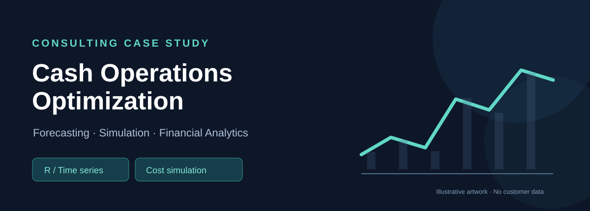
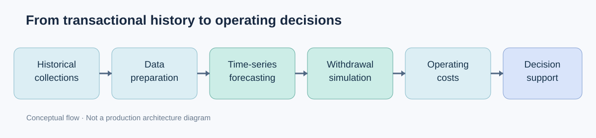
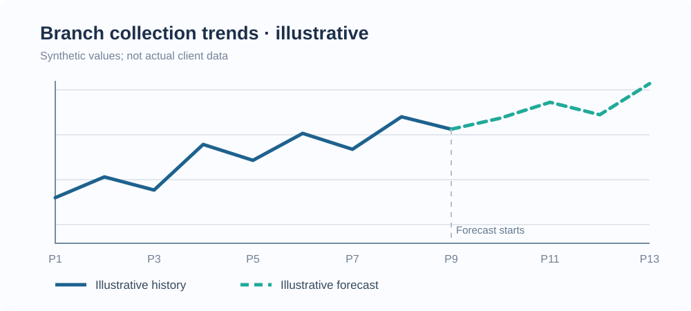
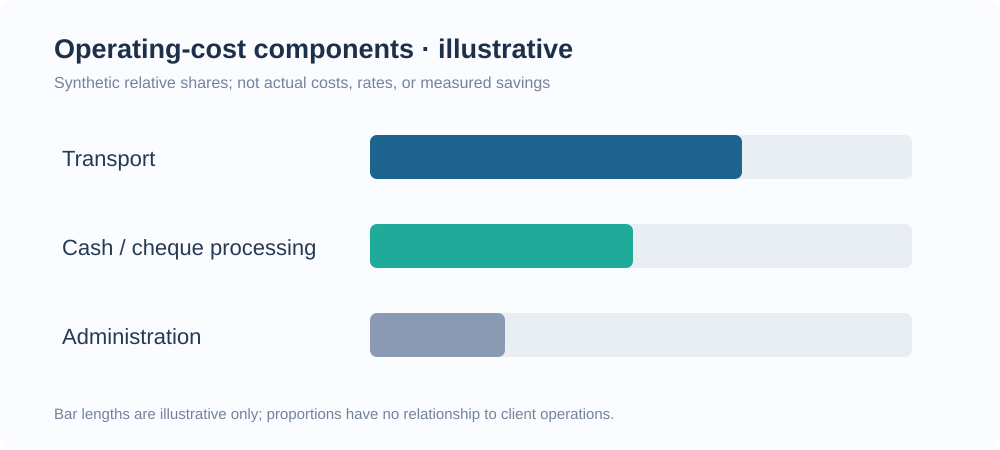

# Cash Operations Optimization

### Forecasting cash collections. Supporting smarter cash-in-transit decisions.

**Consulting case study | Applied Data Science · Operations Research · Financial Analytics**

> **Portfolio presentation only.** This repository contains no source code, customer information, original datasets, contractual rates, or production results. All illustrations are fictional and provided to communicate the analytical approach.

## Executive overview

This consulting engagement developed an analytical workflow to study branch-level cash and cheque collections, forecast incoming amounts, and simulate cash accumulation and withdrawal policies. The solution connected forecasting with cash-in-transit (CIT) cost estimation to support operational planning and cost-aware decisions.

The original implementation and business information are confidential. This public case study describes its scope and technologies without exposing proprietary material.

## Business challenge

Branch cash collection fluctuates across locations and calendar periods. Planning pickups without forward-looking visibility can make it difficult to balance cash exposure, transport frequency, counting requirements, and operating costs.

**The analytical question:** How can historical collection patterns and projected cash flows inform more efficient withdrawal planning?

## Analytical workflow

1. **Prepare the historical data** — consolidate cash and cheque transactions into branch-level daily observations.
2. **Explore collection patterns** — examine date, branch, and calendar effects.
3. **Forecast inflows** — estimate cash and cheque collections with branch-specific time-series regression models.
4. **Simulate withdrawal decisions** — project accumulated cash and withdrawals under defined operating rules.
5. **Estimate operational costs** — model transport, administration, and processing expenses.
6. **Communicate results** — produce visual analyses and Excel-based decision-support outputs.

## Illustrative outputs

The figures below use **synthetic illustrative values**. They are not client results, measured savings, or outputs from the original engagement.

### Historical vs. projected collections

*Illustrative time series showing how a forecast can be compared with historical collection behavior.*

### Operating-cost components

*Illustrative breakdown of transport, cash processing, and administration costs. Proportions are fictional.*

## Decision-support value

- **Forward-looking visibility:** anticipate changes in cash and cheque collections by branch.
- **Better operational planning:** connect projected accumulation with withdrawal scheduling decisions.
- **Cost transparency:** bring multiple cash logistics cost components into one analytical framework.
- **Scenario discussion:** compare the implications of operating rules and cash thresholds.
- **Actionable reporting:** translate data into charts and spreadsheet outputs for business stakeholders.

These describe intended decision-support capabilities, **not quantified or independently verified realized savings**.

## Technologies & methods

| Area | Technologies / approaches |
| --- | --- |
| Language | **R** |
| Data preparation | `dplyr`, `tidyr`, `lubridate` |
| Time-series models | `fable`, `fabletools`, `tsibble`, `feasts`; time-series linear models (**TSLM**) |
| Visualization | `ggplot2`, base R plots |
| External time-series data | `httr`, `jsonlite` for UF reference series |
| Reporting | `writexl` for Excel exports |
| Business modeling | Branch-level cash accumulation, withdrawal-rule simulation, and service-cost estimation |

## Scope and authorship

**Role:** Design and development of the analytical workflow, including data transformations, forecasting models, operational simulation, cost calculations, and decision-support reporting.

This is a retrospective presentation of a completed consulting engagement, **not an open-source software release or a runnable demonstration**.

## Confidentiality

The private project retains all implementation details. No original data, code, customer identity, transaction records, real contractual parameters, or client-specific performance figures are shared here. Diagram labels and visual values are illustrative; they should not be interpreted as exact operational specifications.

---

**Francisco Durán** · Engineer · Data Scientist · Risk & Advanced Analytics
